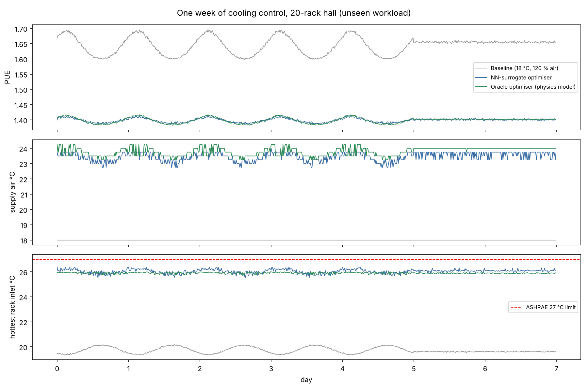
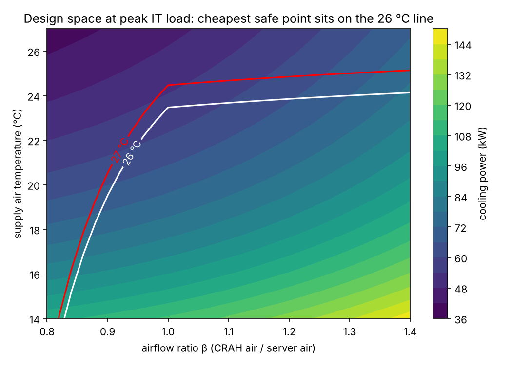
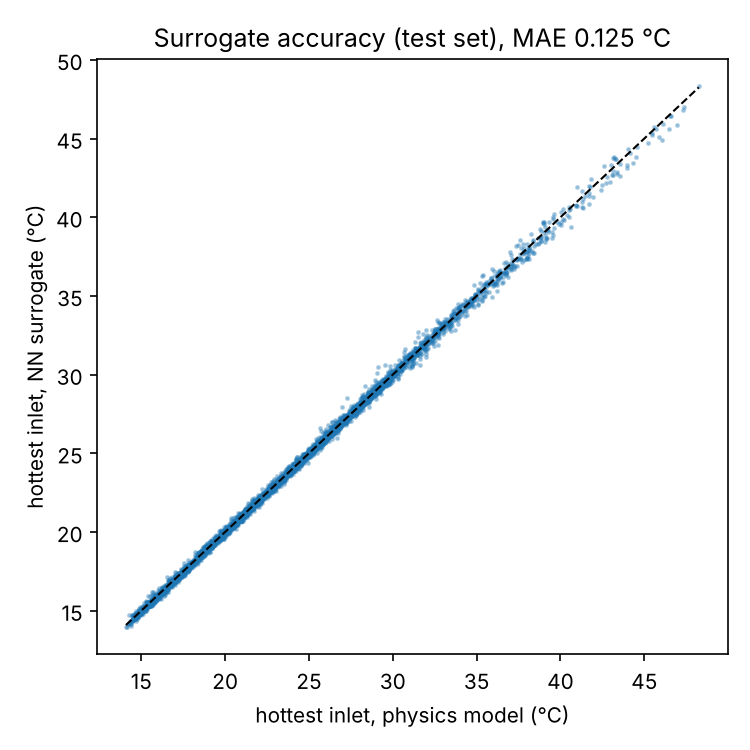

# Data-Center Cooling Set-Point Optimiser with a Neural-Network Surrogate

Choosing the **supply-air temperature** and **airflow** of a data-center cooling unit every 15 minutes so that
cooling energy is minimised while **every rack inlet stays below the ASHRAE 27 °C limit**.
A neural-network surrogate of the hall's thermal behaviour makes the search fast enough for real-time use.



## Results (one week, 15-minute control, unseen workload)

| Strategy | Mean PUE ↓ | Cooling energy (kWh) ↓ | Saving | Hottest inlet seen | Steps over 27 °C |
|---|---|---|---|---|---|
| Baseline: fixed 18 °C supply, 120 % airflow | 1.641 | 13,428 | – | 20.2 °C | 0 |
| **NN-surrogate optimiser** | **1.398** | **7,814** | **41.8 %** | 26.4 °C | **0** |
| Oracle optimiser (physics model) | 1.398 | 7,805 | 41.9 % | 26.0 °C | 0 |

* The surrogate predicts all 20 rack inlet temperatures with **MAE 0.09 °C (R² = 0.999)** on 6,000 unseen cases.
* Using the surrogate instead of the physics model costs only **0.1 %** of the saving.
* The surrogate's small errors pushed the hottest inlet to 26.4 °C against a 26 °C target. This is why the
  optimiser keeps a **1 °C safety margin** under the 27 °C limit: no step violated it.
* Where the saving comes from: a warmer supply (≈ 23.5 °C instead of 18 °C) roughly doubles chiller COP, and
  matching airflow to what servers draw (β ≈ 1.0 instead of 1.2) cuts fan power by ~40 % (fan power ∝ flow³).
* The 42 % figure is relative to a deliberately conservative but common operating practice; savings against an
  already-tuned hall would be smaller. All results come from a simplified model, not a real facility.

## The physics model

A 20-rack hall in a hot-aisle / cold-aisle layout (2 rows × 10 racks, 8 kW racks plus four 14 kW GPU racks).

1. **Server heating.** Each rack draws a fixed airflow `f` sized for a 12 K temperature rise at full power;
   exhaust temperature rise `ΔT = P / (ρ c_p f)`.
2. **Recirculation.** A fraction `ρ_r` of each rack's inlet air is hot exhaust leaking back. It is higher at
   row ends and grows quickly when the cooling unit supplies less air than the servers draw (β < 1).
   Mixing gives a closed-form inlet temperature per row:

   `T_in,r = T_sup + ρ_r · ΔT_row / (1 − mean ρ_row)`

   Derivation: the hot-aisle temperature equals the mean inlet plus `ΔT_row`; substituting
   `T_in,r = T_sup + ρ_r (T_hot − T_sup)` and averaging over the row gives
   `T_hot − T_sup = ΔT_row / (1 − mean ρ)`.
3. **Chiller.** Electric power = heat / COP, with the chilled-water CRAC curve from HP Labs
   (Moore et al., USENIX ATC 2005): `COP(T) = 0.0068 T² + 0.0008 T + 0.458`.
4. **Fan.** Affinity law, power ∝ (airflow)³.
5. **PUE** = (IT + chiller + fan + 6 % other overheads) / IT.

IT workload is synthetic: a daily cycle peaking mid-afternoon, lower weekends, per-rack bias and noise.
Server power is 45 % idle plus 55 % × utilisation.



At peak load the cheapest safe operating point sits where the 26 °C inlet contour turns, at β ≈ 1.0:
less air makes recirculation explode, and more air only costs fan power.

## The surrogate

An MLP (2 × 128 hidden units, scikit-learn) maps (20 rack powers, supply temperature, airflow ratio) to
20 inlet temperatures. It is trained on 24,000 random operating points generated by the physics model and
tested on 6,000 more.



In a real facility the physics model would be a CFD simulation taking minutes per case. The surrogate
replaces it with a microsecond-fast approximation, so the optimiser can test 1,643 candidate set-points
every 15 minutes.

## Run it

```bash
pip install -r requirements.txt
python src/run_optimization.py     # ~20 s; writes results/
```

## Next steps

* Train the surrogate on CFD results (e.g. OpenFOAM) instead of the lumped model.
* Add chiller-plant and outdoor-air (economiser) models, so the outdoor climate matters.
* Use Project A-style load forecasts to plan set-points ahead of workload changes.
